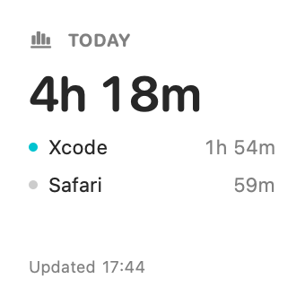
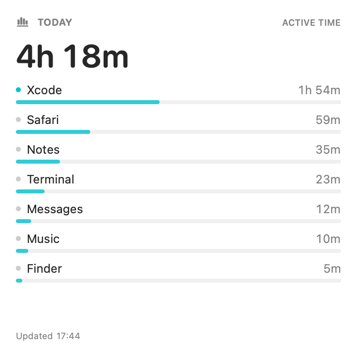
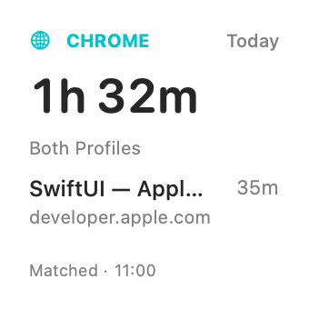
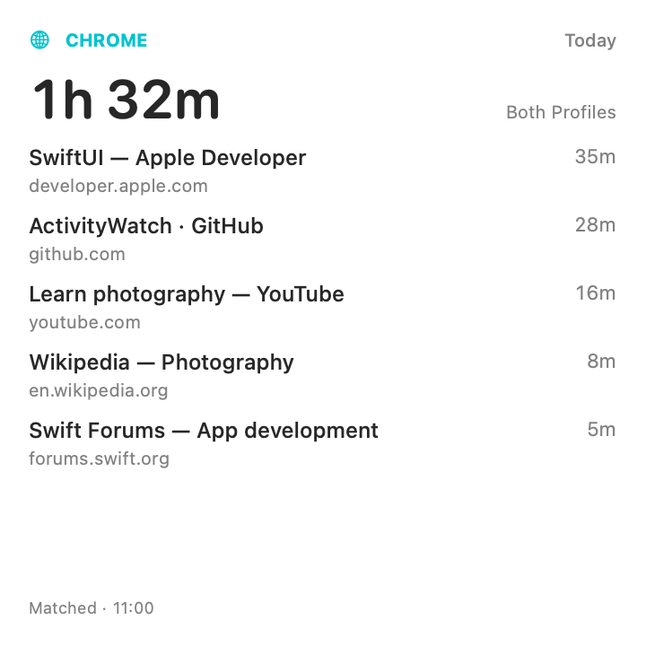

# Widget layout previews

These are offscreen SwiftUI renders using synthetic data. They are not proof of desktop installation or widget registration.

| Size | Preview |
| --- | --- |
| Small |  |
| Medium |  |
| Large |  |

The same widget view is rendered with a fixed family and size for inspection. macOS controls the actual gallery/desktop dimensions, background, tint, and vibrancy.

## Chrome webpage widget (v1.1)

The new independent widget can show either profile or both, grouped by page title or website. These renders use synthetic data.

| Size | Preview |
| --- | --- |
| Small |  |
| Medium |  |
| Large |  |
