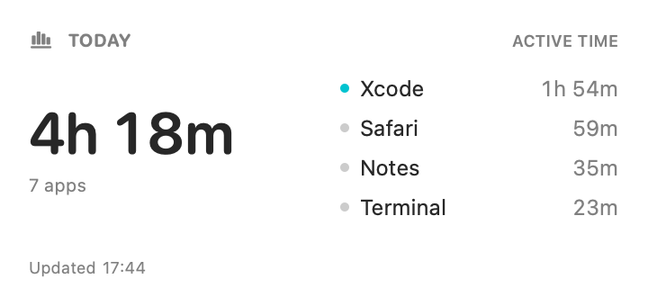
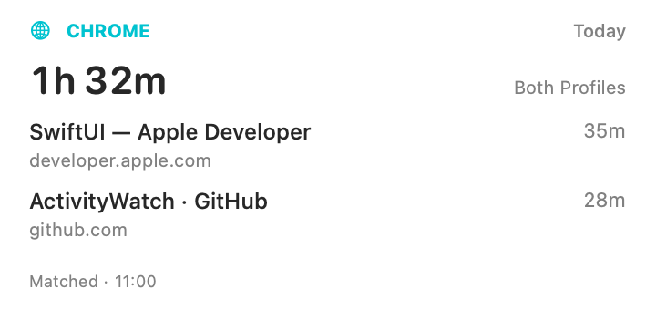

# ActivityWatch Widget for macOS

See today's application usage and Chrome browsing activity in native macOS desktop widgets. Built with SwiftUI and WidgetKit, with a companion menu bar app that reads your local ActivityWatch server.

This repository contains the source project. Build and sign it with Xcode before installing; a signed, notarized installer is not included.

## Widgets

| Widget | Displays | Options |
| --- | --- | --- |
| ActivityWatch Today | Today's application usage time | Small, medium, or large |
| Chrome Web Activity | Today's webpage titles or website domains and browsing time | Profile 1, Profile 2, or Combined; three sizes |

Add widgets through macOS **Edit Widgets**, including on a second display. Add two Chrome widgets to see your Work and Personal profiles side by side.

### Preview

Application activity:



Chrome activity:



These are SwiftUI renders with sample data, not screenshots of a verified desktop installation.

## Get started

1. Run ActivityWatch with its window and AFK watchers.
2. Open `ActivityWatchWidget.xcodeproj` in Xcode, configure your signing team for both targets, and build the **ActivityWatchWidget** scheme for **My Mac**.
3. Install the complete signed app in Applications and launch it.
4. Click **Find Sources**, select your sources, and **Save & Refresh**.
5. Right-click the desktop → **Edit Widgets** → add an ActivityWatch widget.

Follow the [installation guide](INSTALLATION.md) for signing, build commands, installation, and troubleshooting. For separate Chrome profiles, also follow the [Chrome setup guide](CHROME-SETUP.md).

## Requirements

- macOS 14 Sonoma or later.
- Xcode with the macOS 14 SDK or later; Xcode 15 is the baseline. The delivered build was verified with Xcode 27.1; older Xcode versions were not tested.
- A valid Apple signing identity and matching signing team for the host and widget extension.
- ActivityWatch running locally, normally at `http://localhost:5600`.
- For Chrome details: the ActivityWatch Web Watcher extension in each Chrome profile, configured with distinct source names.

There are no third-party Swift dependencies or project-generation steps. See the [verification report](BUILD-VERIFICATION.md) for tested configurations and runtime checks still outstanding.

## Everyday use

**Xcode does not need to stay open.** Launch the installed app and keep ActivityWatch running. Closing the dashboard leaves the menu bar updater running; choosing Quit stops it. Enable **Open at login** from the installed app if desired.

The host fetches activity about once per minute while running. WidgetKit decides when the widget actually redraws, so the desktop display may lag behind the dashboard. The app reads ActivityWatch records; ActivityWatch's watchers collect the underlying activity.

## Installation 
[Installation Guide](INSTALLATION.md)

## What the numbers mean

- “Today” is midnight through the request time, using the Mac’s current calendar/time zone. Calendar arithmetic handles 23- and 25-hour days.
- **Exclude idle time** intersects window activity with the selected AFK watcher’s `not-afk` periods. Missing AFK coverage is excluded. Turning it off displays **foreground time**, which can include time when you were away.
- The REST query aggregates by application on the ActivityWatch server. It does not merge multiple computers or overlapping window buckets. App labels are exactly those reported by the watcher; unknown/missing labels are displayed as “Unknown app” when returned by the server.
- The app shows all-app totals and up to 12 rows; widgets show the top 2/4/7 applications. All-app totals include rows outside the visible list. Durations are rounded down to whole minutes, so displayed rows may not add exactly to the displayed total.
- The latest window-record timestamp in the dashboard helps identify a stopped watcher. “Updated” means the API was fetched, not that the watcher has recorded new activity. A successful API response with no events is shown as an empty day.
- The original widget remains a focused application-time view; the separate Chrome widget provides domain/title breakdowns. It does not reproduce ActivityWatch dashboard categories, excluded apps, custom day-start offsets, “always active” rules, or multiple-device union rules.

## Refresh and background behavior

| Component | Behavior |
| --- | --- |
| Host app | Polls about once per minute while running, with timer tolerance; refreshes after wake. Closing its window leaves the menu bar running. Sleep/App Nap can defer work. |
| Host → widget | Requests `WidgetCenter.reloadTimelines` no more than once per five minutes during automatic polling. Explicit Refresh and settings changes request a reload immediately. |
| Widget extension | Reads the shared snapshot, then attempts a short local REST fetch whenever WidgetKit requests a timeline. Requests its next timeline after five minutes. Works without the host running when the OS grants an update. |
| Stale/offline | Uses the last successful same-day cache with an offline/saved-data label. A scheduled entry marks data old after 15 minutes. |
| Midnight | A prebuilt timeline entry clears yesterday’s display while awaiting the next fetch. Time-zone changes invalidate cached-day matching on the next timeline generation. |

**Five minutes is a request, not a guarantee.** WidgetKit applies its own budgets and scheduling; reload requests do not force immediate display changes. There is no perpetual process inside the extension, no iOS-only background-fetch workaround, and no promise of updates while the Mac is asleep. Keep the host’s menu bar running for more opportunities to update, or click the widget to open the dashboard and refresh.

## Architecture and privacy

```text
ActivityWatch local REST API
        ↑                    ↑
SwiftUI host             Widget timeline provider
        ↘                    ↙
      Signed shared App Group
      settings.json + snapshot.json + browser-snapshot.json
```

- `App/`: dashboard, source selection, menu bar, optional login registration, timer/wake updates.
- `Widget/`: WidgetBundle with the application widget and an AppIntent-configurable Chrome widget, each in three sizes.
- `Shared/BrowserActivity.swift`: browser/foreground-window/AFK interval matching, profile validation, and domain/title summaries.
- `Shared/`: Foundation-only client, models, formatting, and file store compiled into both targets.
- `Config/`: Info.plists, sandbox/network/App Group entitlements, shared signing settings.
- `Tests/`: independently runnable Swift Package tests, including a real-server fixture test.

The shared container is located through `FileManager.containerURL`, never by bypassing the sandbox. Atomic writes plus a cross-process file lock prevent partial reads; request timestamps and settings revisions reject outdated writes. A configuration change invalidates the old snapshot. Both processes have outgoing-network sandbox permission. ATS permits local HTTP connections; URL validation limits configuration to `localhost`, `127.0.0.1`, or `::1`.

The app reads bucket metadata, sends read-only queries via `POST /api/0/query/`, and reads the latest window event for watcher freshness. HTTP POST here is a query and does not create records. The application cache stores app names, durations, source identifiers, timestamps, and settings. The Chrome feature additionally caches webpage titles, domain names, and durations per selected profile. It temporarily reads same-day window/browser/AFK records to match foreground activity; full URLs are used only in memory and never saved in the shared cache. It does not read page bodies or Google account identities. There are no analytics or remote services. This version supports the default unauthenticated loopback API; optional API-key-protected servers are not implemented and produce an explicit access error.

## Tests

```sh
DEVELOPER_DIR=/Applications/Xcode.app/Contents/Developer \
  swift test --scratch-path /tmp/ActivityWatchWidget-tests
```

Thirteen tests run by default. Two additional real-server tests are skipped unless `AW_TEST_SERVER` is configured. Tests cover URL validation, safe source selection, query escaping, aggregation, transport decoding, local-day/DST behavior, cache revision invalidation, and rejecting old writes.

To run the real-server test without touching your records, start a **separate empty** `aw-server-rust` database on port **5679**. Example for the ActivityWatch installation used during verification:

```sh
mkdir -p /tmp/aw-widget-fixture
touch /tmp/aw-widget-fixture/config.toml
/Applications/ActivityWatch.app/Contents/Frameworks/aw-server-rust \
  --profile widget-fixture --host 127.0.0.1 --port 5679 \
  --config /tmp/aw-widget-fixture/config.toml \
  --dbpath /tmp/aw-widget-fixture/fixture.db --no-legacy-import
```

In another Terminal, from this project directory:

```sh
python3 Scripts/seed-fixture.py
AW_TEST_SERVER=http://127.0.0.1:5679 \
  DEVELOPER_DIR=/Applications/Xcode.app/Contents/Developer \
  swift test --scratch-path /tmp/ActivityWatchWidget-tests
```

The seed script refuses unrelated or populated buckets. Synthetic records span midnight and the query’s end boundary. Expected application results: **150 seconds active**, **210 seconds foreground**. Separate Chrome fixture buckets produce **30 seconds for each profile**, plus **30 ambiguous seconds** that are excluded from assigned totals. Stop the separate server with Control-C when finished. CLI flags may differ with other ActivityWatch releases; consult that binary’s `--help`. Never point the fixture script at your normal database.

## Troubleshooting

- **No widget in the gallery:** confirm macOS 14+, build the host scheme, check the app contains `Contents/PlugIns/ActivityWatchWidgetExtension.appex`, use the same valid signing team on both targets, install and launch the host once, then reopen Edit Widgets. If necessary log out/in. Avoid having multiple copies of this bundle identifier installed during testing.
- **Shared storage unavailable:** check that `DEVELOPMENT_TEAM` is not blank and `ACTIVITY_APP_GROUP` resolves identically in both products’ Info.plists and signatures. Changing the group creates a fresh settings/cache location. Rebuild both targets together.
- **Cannot connect:** start ActivityWatch, check its local dashboard/port, and use `localhost` for the default setup. A running web dashboard with no events usually indicates a watcher/Accessibility problem; the widget cannot invent records.
- **More than one source:** choose the correct `currentwindow` bucket explicitly. AFK must be from the same hostname. Automatic selection prefers the server hostname; it refuses ambiguous choices.
- **Zero active time:** check the AFK watcher. As a diagnostic, turn off idle exclusion and save; the label becomes foreground time.
- **Old numbers:** check the fetched timestamp and latest record in the host. Keep the updater and ActivityWatch running; WidgetKit can delay a reload after successful fetching.
- **Login item needs approval:** enable it in System Settings → General → Login Items. Register it only from the installed app location.
- **“Resource fork, Finder information, or similar detritus not allowed” during signing:** build in a fresh temporary directory or Xcode’s default DerivedData folder, outside cloud-synced Documents/Desktop. The supplied build script and test commands already keep their products outside the project folder.

## Verification delivered

See [BUILD-VERIFICATION.md](BUILD-VERIFICATION.md) for the actual environment, passed checks, and runtime checks still requiring your signing identity. No private ActivityWatch records are included.

## References

- [Apple: Creating a widget extension](https://developer.apple.com/documentation/widgetkit/creating-a-widget-extension)
- [Apple: Keeping a widget up to date](https://developer.apple.com/documentation/widgetkit/keeping-a-widget-up-to-date)
- [Apple: Network requests in a widget extension](https://developer.apple.com/documentation/widgetkit/making-network-requests-in-a-widget-extension)
- [Apple: App Groups entitlement and macOS team-prefixed identifiers](https://developer.apple.com/documentation/bundleresources/entitlements/com.apple.security.application-groups)
- [ActivityWatch REST API](https://docs.activitywatch.net/en/latest/api/rest.html)
- [ActivityWatch query examples](https://docs.activitywatch.net/en/latest/examples/working-with-data.html)

MIT licensed; this is an independent companion project, not an official ActivityWatch release.
